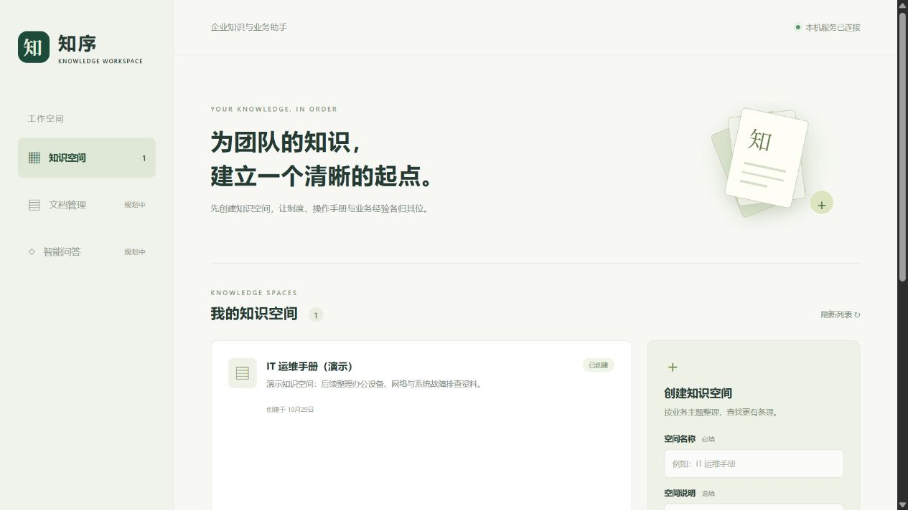

# 企业级智能知识库与业务助手平台

Enterprise Knowledge Assistant：面向企业内部文档检索、知识问答及 IT 业务辅助场景的个人实践项目。

**当前阶段：可运行的基础框架。** 已实现知识空间创建、列表查询、SQLite 持久化和前后端连通；文档导入、向量检索、RAG 问答、引用来源及权限管理尚未实现。“企业级”描述的是建设目标，不代表已具备生产交付能力。



## 技术方案

- 前端：Vue 3、TypeScript、Vite。
- 后端：Python 3.11+、FastAPI、Pydantic Settings。
- 存储：SQLite，数据默认保存在本机 `data/`。
- 模型：预留 DeepSeek 等远程模型接口，当前版本不发起模型调用，无需 API Key 或独立显卡。
- 开发环境：Windows PowerShell 优先，同时支持手动在 macOS/Linux 启动。

## 已实现与规划

| 模块 | 状态 | 当前行为 |
| --- | --- | --- |
| 后端健康检查 | 已实现 | 检查本地数据库；不访问模型或外网 |
| 知识空间管理 | 已实现 | 创建、列表、详情，重启后保留 |
| 前端工作台 | 已实现 | 查看服务状态、创建和浏览知识空间 |
| 文档导入与分段 | 规划中 | 仅预留模块边界 |
| 向量检索与 RAG | 规划中 | 仅预留类型与接口 |
| 智能问答与引用 | 规划中 | API 返回明确的 501，绝不生成模拟答案 |
| 用户与权限 | 规划中 | 当前仅限本机开发，不作为公网服务部署 |

## 快速开始

准备 Python 3.11+、[uv](https://docs.astral.sh/uv/getting-started/installation/)、Node.js 22.12+（建议 Node.js 24 LTS，包含 npm）。

```powershell
git clone https://github.com/yuhh76541-creator/enterprise-knowledge-assistant.git
cd enterprise-knowledge-assistant
Copy-Item .env.example .env
cd backend
uv sync --frozen --extra dev
cd ..\frontend
npm ci
cd ..
```

Windows 启动与停止：

```powershell
powershell -NoProfile -File .\scripts\Start-Dev.ps1
powershell -NoProfile -File .\scripts\Stop-Dev.ps1
```

- 工作台：<http://127.0.0.1:5310>
- 后端文档：<http://127.0.0.1:8100/docs>
- 健康检查：<http://127.0.0.1:8100/api/v1/health>

端口固定为 5310 和 8100，避免占用 Resume Matcher 使用的 3000/8000。启动脚本遇到端口占用会直接报错，不终止其他服务。日志和本次启动的进程记录放在 `.runtime/`，未设置开机自启。

也可在两个终端手动运行：

```powershell
# 终端一：backend 目录
uv run --frozen uvicorn app.main:app --host 127.0.0.1 --port 8100

# 终端二：frontend 目录
npm run dev
```

## 验证

```powershell
cd backend
uv run --frozen --extra dev pytest
cd ..\frontend
npm run build
```

后端测试使用临时数据库，不会修改你的知识空间，也不会调用付费模型。前端构建包含 TypeScript 检查。

初始框架已验证：后端 5 项测试通过、Python 静态检查通过、前端正式构建通过；在页面创建演示知识空间并重启，记录仍可读取。详见 [验证记录](docs/VERIFICATION.md)。

## 目录

```text
backend/                FastAPI、SQLite、接口契约和测试
frontend/               Vue 工作台、API 客户端和类型
docs/                   架构、接口说明与开发路线
examples/               可公开使用的演示知识资料
scripts/                Windows 启停脚本
data/                   本地数据库和后续用户文档（不入库）
.env.example            配置示例（不含真实密钥）
```

下一步从 [开发路线](docs/ROADMAP.md) 的文档导入开始，设计见 [架构说明](docs/ARCHITECTURE.md)，接口见 [API 说明](docs/API.md)。本仓库暂未指定开源许可证。
